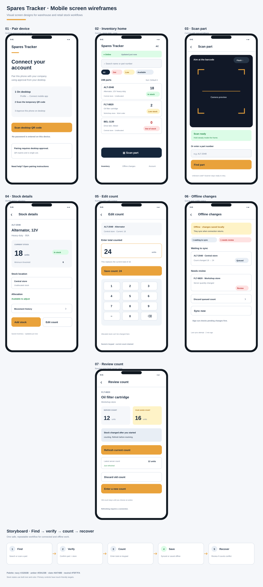
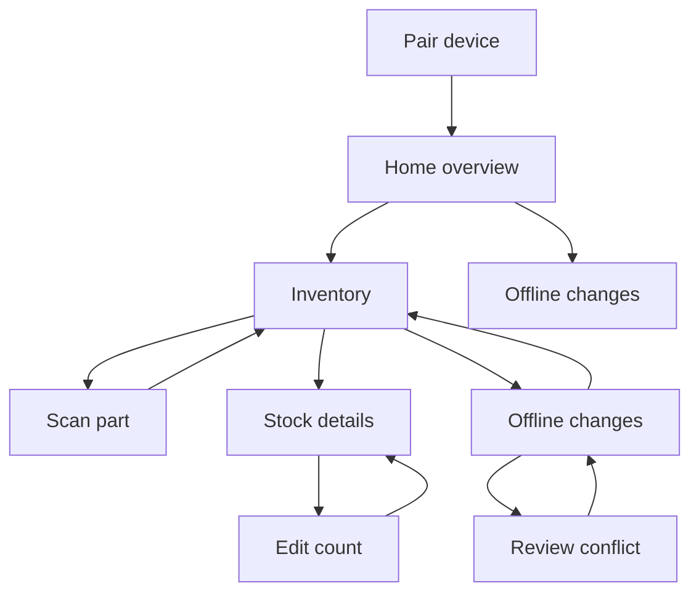

# Mobile Screen Wireframes and Storyboard

**Status:** Design baseline for the next UI sprint  
**Date:** 2026-10-25  
**Product:** Spares Tracker mobile  
**Scope:** Existing mobile workflows, using the current API and mock data where backend integration is unavailable

This document turns the mobile UX principles into a screen-by-screen design. It is the source of truth for follow-up UI changes: implement and review one screen or one cohesive state family at a time, then validate the end-to-end storyboard.

## Visual wireframes

The vector screen board below shows all seven primary screens and the end-to-end find-to-recovery storyboard. Open the SVG directly for a scalable view.

## Product priorities

1. Let a worker identify a part and its available quantity in a glance.
2. Keep the frequent path (search or scan → inspect → count) short and thumb-friendly.
3. Make saved, syncing, offline, and needs-review states visible without relying on color alone.
4. Prevent accidental count loss, zeroing, or sign-out while local changes remain.
5. Keep authorization server-led. Cached inventory is useful offline only for a previously valid account; 401/403 responses do not grant offline access.

## Screen map

The inventory screen is the home hub. Scanner, details, count editing, and offline review are task screens or overlays; they should preserve context and return workers to the same inventory search/filter state.

## Shared layout and interaction rules

| Element | Design rule |
| --- | --- |
| Safe area and page frame | Respect device insets. Use a pale neutral page, white content surfaces, navy headings, and slate supporting text. |
| Brand | Use the supplied Spares Tracker mark/wordmark. Do not replace the approved logo with a text approximation. |
| Touch | Primary and repeated actions have at least 44 × 44 pt hit areas; aim for 48 pt where space allows. |
| Status | Pair every semantic color with text or an icon. Stock: green healthy, amber low, red out. Offline: slate/amber label plus plain-language copy. |
| Navigation | Keep a visible back/close action on task screens. Returning from detail restores the previous inventory context. |
| Numeric entry | Use a numeric keypad, select the current value on focus, and keep the item name and current count visible while editing. |
| Feedback | Confirm successful saves inline or in a short-lived message. Offer Undo when a change is reversible and has not been synced. |
| Loading | Use inventory-shaped skeleton rows for initial fetches. Keep pull-to-refresh for a populated list; avoid blocking spinners for routine refresh. |
| Accessibility | Use a logical heading order, descriptive action labels, announced result counts, and status labels that do not rely on color. |

## Screen 1 — Pair device

**Purpose:** Explain the desktop approval step and begin a secure mobile pairing session.

**Layout, top to bottom:**

1. Supplied brand mark and “Spares Tracker”.
2. Heading: “Connect your account”.
3. Short explanation: sign in on desktop, open Profile → Connect mobile app, then scan its temporary QR code.
4. Large primary action: “Scan desktop QR code”.
5. Secondary help text: QR codes expire; no password is entered on this device.
6. When approval is pending, show the device label, “Waiting for desktop approval…”, a cancel action, and expiry/retry guidance.

**States:** ready, camera permission required/denied, invalid or expired QR, waiting for approval, approved/loading inventory, retryable connection failure.

**Primary zone:** Scan action near the lower half of the screen; cancel remains reachable during approval.

## Home overview

**Purpose:** Give a compact view of stock health and a direct route into inventory work.

- Show a small three-metric summary: total items, low stock, and out of stock.
- List only the most urgent items under “Needs attention”; avoid charts or repeated summary cards.
- Keep shortcuts to Inventory and Scan visible.
- Use the persistent bottom navigation for Home, Stock, Scan, Changes, and More.

## Screen 2 — Inventory home

**Purpose:** Search, triage, and open a stock item quickly.

**Layout, top to bottom:**

1. Compact branded header with current account/company context and account action.
2. Offline/sync status strip when relevant. Example: “Offline · saved inventory” plus last refresh time and queued count.
3. Persistent search field. Hint: “Search part name or number”. Keep the clear action inside the field.
4. Keep quick filters to a small set such as All and Needs attention; open the full filter sheet for stock status and allocation. This keeps the list uncluttered while common triage stays one tap away.
5. Result summary with visible count; sort control for Default, Part number, and Lowest stock.
6. Dense but readable inventory rows.
7. Persistent bottom navigation for Home, Stock, Scan, Changes, and More, with Scan kept in the thumb zone. The More destination opens account and settings actions.

Each inventory row presents:
- Part number and short description as the strongest text.
- Quantity with unit label and a clear stock status badge.
- Store/location name and allocation/work-order context as secondary metadata.
- Minimum threshold when it helps explain a low-stock state.
- A full-row tap target that opens details; avoid tiny separate controls.

**Populated row priority:** part identity → count/status → location/context. Never use a wide desktop-style column grid on a narrow phone.

**States:**
- Initial load: 4–6 skeleton rows matching the final row geometry.
- Empty inventory: explain that no stock items are available.
- No search/filter matches: preserve the query and offer “Clear search” and/or “Show all”.
- Offline snapshot: keep the banner visible and display its last-saved time.
- Error without usable snapshot: concise message and a retry action.
- Refreshing: retain visible rows and show non-blocking refresh feedback.

## Screen 3 — Scan part

**Purpose:** Find a part by scanning its barcode/QR or entering a part number.

**Layout, top to bottom:**

1. Header with close/back, “Scan part”, and torch toggle.
2. Camera preview occupying most of the usable area.
3. Centered scan frame and brief instruction: “Align barcode within the frame”.
4. Bottom manual entry field for part number, with a numeric/text keyboard appropriate to the input.
5. Permission, scanning, found, and not-found messages rendered in a high-contrast panel above the input.

**Behavior:** A successful recognized code gives immediate haptic feedback and opens the matching item detail. Unsupported or unknown values give a distinct failure message and keep the camera ready for another scan. Preserve inventory context when returning.

**Constraints:** The current v1 inventory record only supports lookup by part number; do not imply barcode, serial, supplier, aisle, or bin search until the API provides those fields.

## Screen 4 — Stock details

**Purpose:** Confirm identity, location, quantity, status, and whether the user can safely count the item.

**Layout, top to bottom:**

1. Back action and “Stock details”.
2. Part number and full description.
3. Prominent quantity panel: current count, unit, semantic status, and minimum threshold.
4. Store/location and allocation/work-order details.
5. If the user has permission and the item is not allocated: bottom action area with “Add stock” and “Edit count”.
6. If offline changes affect this item: clear “Saved on this device” or “Needs review” explanation and next action.

**States:** loading, ready, not found, retryable load failure, allocated/read-only, offline with queued change.

## Screen 5 — Count editor

**Purpose:** Add a received quantity or set the counted total with explicit context.

**Presentation:** A focused sheet or page that retains a compact item identity header; do not obscure the item being counted.

**Layout:**

1. Close/back action and action title: “Add stock” or “Edit count”.
2. Part number, description, store, and current quantity.
3. Large numeric value field with numeric keypad; show the expected total for Add stock before submission.
4. Plain-language helper text:
   - Add stock: “This adds to the current count.”
   - Edit count: “Enter the total you counted.”
5. Primary action with explicit outcome (“Add 4” / “Save count”).
6. For setting a positive count to zero: a separate confirmation step that names the item and says it will be marked out of stock.
7. After save: updated total, queued/synced status, and an Undo action while the queued change is still reversible.

**Validation:** whole numbers only; Add stock must be greater than zero; Edit count may be zero. Prevent repeat submission while saving.

## Screen 6 — Offline changes

**Purpose:** Show local work clearly and let users resolve failures before they leave the account.

**Layout, top to bottom:**

1. Back action and “Offline changes”.
2. Summary counts: “Waiting to sync” and “Needs review”.
3. Plain-language connectivity/sync state and last attempt where available.
4. Grouped change rows showing part number, store, desired count, and state.
5. Each conflict row exposes “Review count”; queued rows expose only safe actions such as “Discard change” with confirmation.
6. If online, a clear “Sync now” action and per-row progress/result.
7. Empty state: “All changes are synced” with a return-to-inventory action.

**Error prevention:** Sign-out checks this queue first. If changes remain, show how many and offer “Stay signed in” and “Sign out anyway” as distinct choices.

## Screen 7 — Review a conflicted count

**Purpose:** Resolve a stale count using the latest server value.

**Layout:**

1. Back action and “Review count”.
2. Part identity and store.
3. Side-by-side or vertically stacked values with explicit labels: “Current server count” and “Your saved count”.
4. Short explanation that someone changed the stock after this device began counting.
5. Primary action: “Refresh current count” to fetch the latest server value.
6. After refresh, show the refreshed quantity and actions: “Discard old count” or “Enter a new count”.
7. Require a confirmation before discarding; do not silently replace a local count.

**States:** refreshing, refresh failed (keep conflict intact), refreshed, discarded, offline (explain connection is required to refresh).

## Screen 8 — System feedback states

These are shared screen states, not separate destinations.

| State | Presentation |
| --- | --- |
| Saved locally | “Saved on this device · will sync when online” plus queued count. |
| Syncing | “Syncing changes…” and per-item progress without blocking inventory browsing. |
| Needs review | Amber/red semantic accent, explicit text, and a direct route to review. |
| Offline | “Offline · saved inventory” plus freshness time; do not imply server data is current. |
| Permission/session expired | Explain sign-in is required. Never show a cached fallback after access is denied. |
| Reversible action complete | Brief confirmation and an Undo action before sync commits it. |

## Storyboard A — Find and count a part

1. Worker opens Inventory; existing rows remain useful while refresh runs.
2. Worker types a part number or taps Scan.
3. Search results narrow with a visible item count, or the scan opens the exact matching detail.
4. Worker confirms part number, store, quantity, and allocation state.
5. Worker taps Edit count; numeric keypad opens with the current count selected.
6. Worker enters the total, reviews the item context, and saves.
7. UI immediately shows the new count and “Saved on this device” or “Synced” state.
8. If queued and still reversible, worker can tap Undo.

## Storyboard B — Work through a connectivity drop

1. Inventory is already loaded and shows its last refresh time.
2. Device loses connectivity; the status strip changes immediately to “Offline · saved inventory”.
3. Worker opens a part and records a count; the UI confirms it is saved locally.
4. When connectivity returns, the app attempts to sync and shows progress.
5. If server quantity changed, the row moves to Needs review; subsequent edits for that part are held.
6. Worker opens Review count, fetches the latest server count, then discards the outdated value or enters a new count.

## Storyboard C — Scan repeatedly on the warehouse floor

1. Worker taps the bottom Scan action from Inventory.
2. Camera opens with a clear scan frame and torch control.
3. A recognized part number triggers haptic confirmation and opens its detail.
4. An unknown/unsupported code triggers distinct failure feedback; the scanner remains ready.
5. Worker returns to Inventory with the prior query, filter, and scroll position intact.

## Storyboard D — Leave safely

1. Worker taps account/sign-out.
2. App checks the local queue.
3. With no pending changes, sign-out proceeds after server confirmation.
4. With queued/conflicted changes, the app reports the count and offers “Stay signed in” or “Sign out anyway”.
5. If sign-out fails due to a temporary connection error, retain the local queue and explain the retry.

## Build sequence

| Step | Screen slice | Acceptance focus |
| --- | --- | --- |
| 1 | Inventory home and its loading/empty/error states | Search/filter context, scannable rows, skeleton geometry, scanner reach |
| 2 | Stock details and count editor | Item identity, numeric entry, zero confirmation, undo/saved feedback |
| 3 | Offline changes and conflict review | Fresh server quantity, safe discard, sign-out protection |
| 4 | Scanner task flow | Permissions, repeat scan ergonomics, feedback, preserved inventory context |
| 5 | End-to-end storyboard review | Complete find/count/offline/recovery flows with mock data and on-device validation when available |

Backend-dependent features (barcode fields, supplier/serial/location search, bulk location edits, export, and paginated server search) stay out of these screens until the API supports them. Use mock data for visual and interaction review where live SaaS/PostgreSQL is unavailable.
